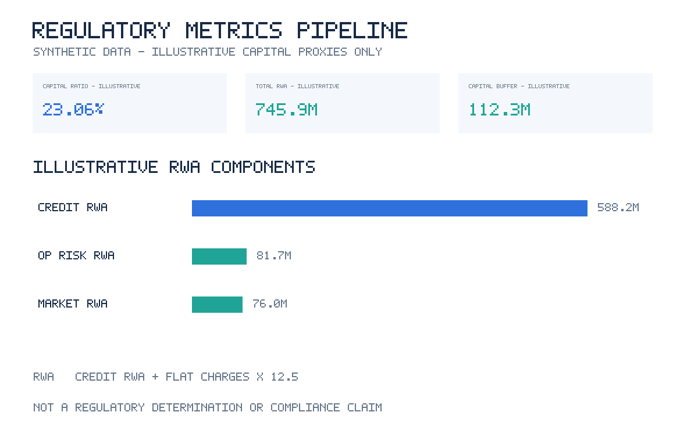
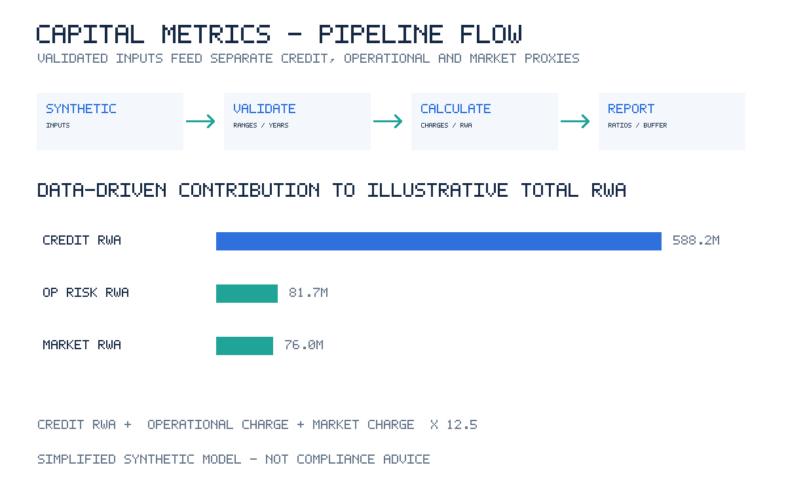

# Regulatory Metrics Pipeline

A dependency-free Python standard-library demonstration of input validation and
transparent, illustrative capital/risk arithmetic. All sample institution,
exposure, and income data are synthetic.

> **Important:** This is not a regulatory reporting system, compliance tool, or
> implementation of any current jurisdiction's rules. Its assumed rates,
> risk weights, multipliers, and illustrative floor are simplified teaching
> parameters and must not be presented as a regulatory determination.

## Run

```sh
PYTHONPATH=src python3 -m regulatory_metrics_pipeline examples/sample_metrics.json
PYTHONPATH=src python3 -m unittest discover -s tests -v
```

Use `-o results.json` to write output to a file. The sample demonstrates the
input format. The package validates finite, non-negative capital/exposures and
income, three annual gross-income observations, risk weights from 0 to 2,
unique exposure labels, and bounded illustrative rates.

## Precisely defined illustrative model

- Credit risk-weighted assets are the sum of exposure amounts multiplied by
  the supplied risk weights.
- The operational charge proxy is the three-year arithmetic average of gross
  income multiplied by the configured flat rate (15% by default).
- The market charge proxy is reported market exposure multiplied by the
  configured flat rate (8% by default).
- Each non-credit charge is converted to risk-weighted assets using a configured
  multiplier (12.5 by default); total illustrative RWA sums these components.
- The capital ratio is eligible capital divided by illustrative total RWA. The
  illustrative buffer compares capital with an explicitly configured floor
  (8% by default). The leverage proxy uses capital divided by credit plus
  market exposure.

These assumptions are deliberately not a statement of current regulatory
requirements. Interpret results only as reproducible output from the stated
synthetic inputs and formulas.

## Reports

Generate both overview and calculation-flow reports (SVG and PNG) with:

```sh
PYTHONPATH=src python3 reports/build_screenshots.py
```

### Project overview



### Calculation flow


